# Classic HS

A fan remake of **Hearthstone Classic** as it was in June 2014, before Naxxramas: all 382 Basic and Classic cards, nine classes, the original tutorial, a bot, and online play with a friend straight from the browser — without a game server.

**▶ Play: https://pycz2.github.io/classichs/** · [Changelog](CHANGELOG.md) · [На русском](#на-русском)

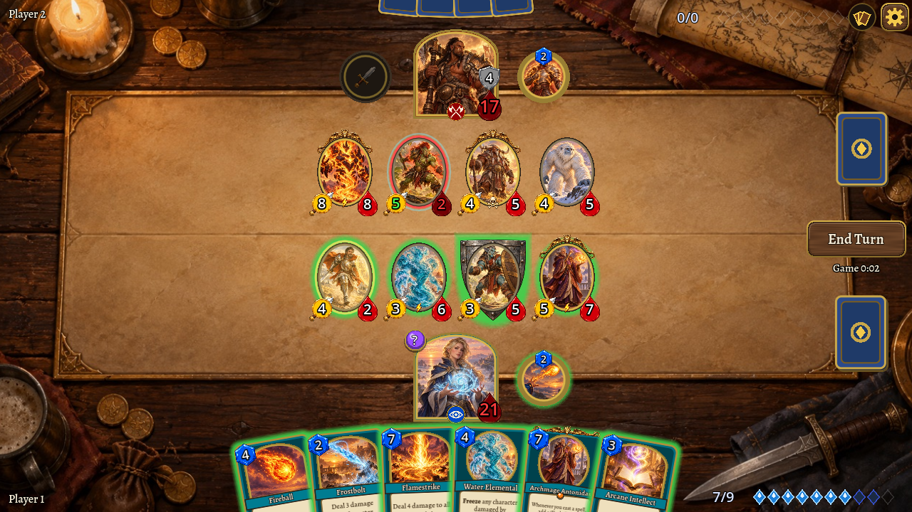

## Features

- **All 382 cards** with original names, values and mechanics: Secrets, Choose One, Overload, Combo, Enrage, Deathrattle, auras, transformations and more.
- **Training** against a simple bot of any class with a Basic deck, one of ten well-known Classic decks or your own; once loaded, it needs no internet.
- **Online play without a server.** WebRTC connects two browsers directly (public Google STUN; a free public TURN relay when networks block a direct link). One player creates an invite code, the other answers with a code; the codes go through any messenger. Both games run the same deterministic engine in lockstep and check the game state after every move. 75-second turns with a burning fuse.
- **Arena with a friend** (online): the host chooses one deck for the whole Arena or a new deck for every game (optionally players may keep their last deck); each player takes one of three heroes and drafts 30 cards like the 2014 Arena — three cards of one rarity per pick, Rare or better at picks 1, 10, 20 and 30, class cards more often, no limit on copies (normal pick odds 76.5/14/7.5/2 %); both see each other's progress, then play until one has three wins (concede or leave at any stage).
- **Tutorial** like the original: six missions as Jaina against Hogger, Millhouse Manastorm, Lorewalker Cho, King Mukla, Hemet Nesingwary and Illidan Stormrage.
- **Collection and decks:** every card unlocked, unlimited decks saved in the browser, ten well-known Classic decks ready to play, Hearthstone-compatible deck codes (import and export).
- **Deck tracker** (your deck, cards left with the chance to draw each one, what the opponent played) and the **move history** by turns: a tile for every move, hover it to see what it did; the full text history on a click.
- **Debug tools** (Settings): build any position with the mouse (or in JSON) and play it against the bot or for both sides; a test scene for each of the 534 cards and tokens; any card with any effect.
- **8 languages** (English, Русский, Deutsch, Français, Español, Português (Brasil), Italiano, Polski), synthesized sound and music, 6 emotes in the heroes' own words (speech bubbles) and mute, six card backs, animation speed, screen shake toggle, fullscreen.
- **Web app:** the browser version can be installed as an app (PWA); after the first runs the browser keeps the game files, so it starts faster and opens offline.
- **Card art:** generated illustrations for every card and hero (see *Card art sets* below); frames, gems and table effects are drawn by code.

| | |
|---|---|
| 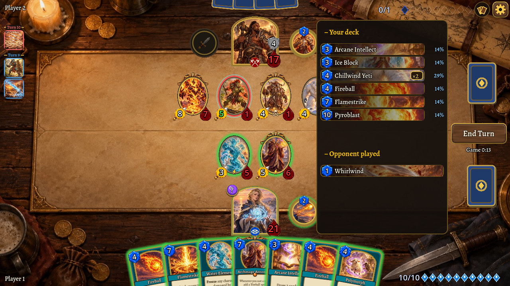 | 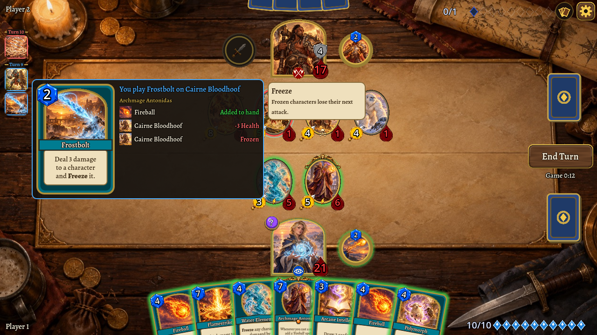 |
| 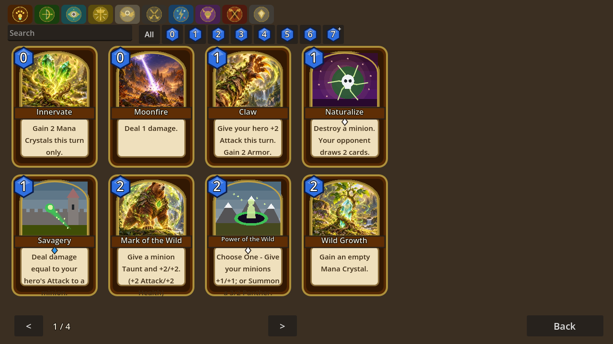 | 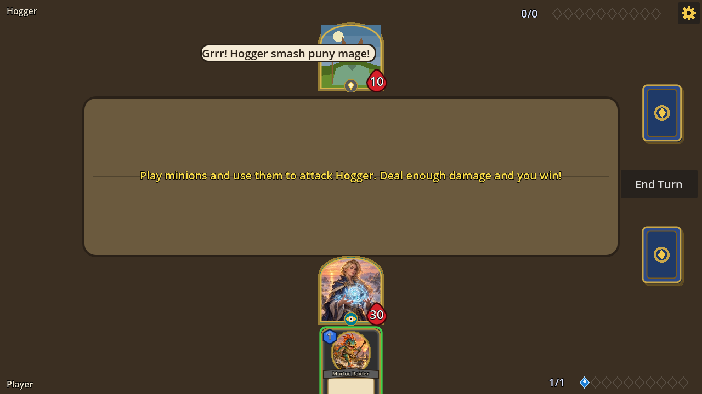 |
| 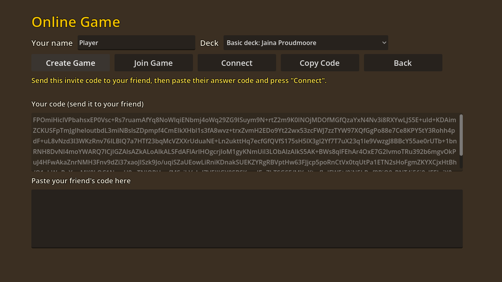 | 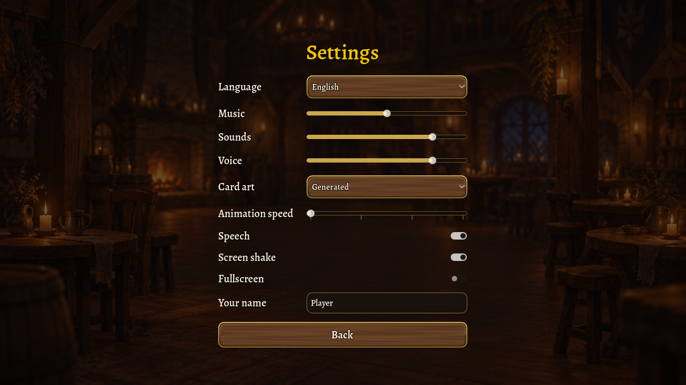 |
| 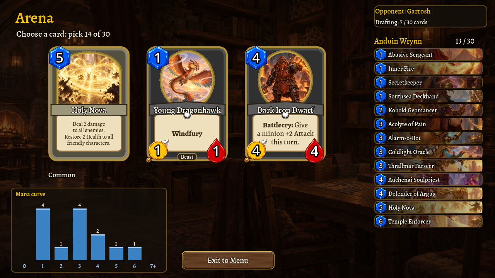 | 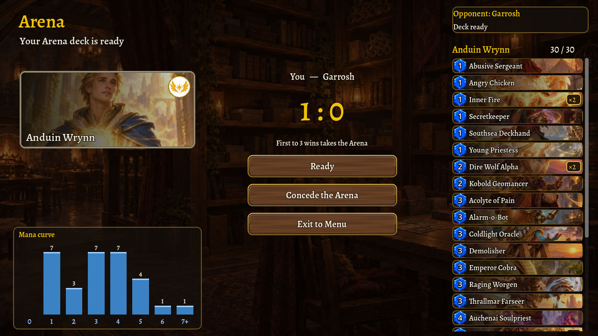 |
| 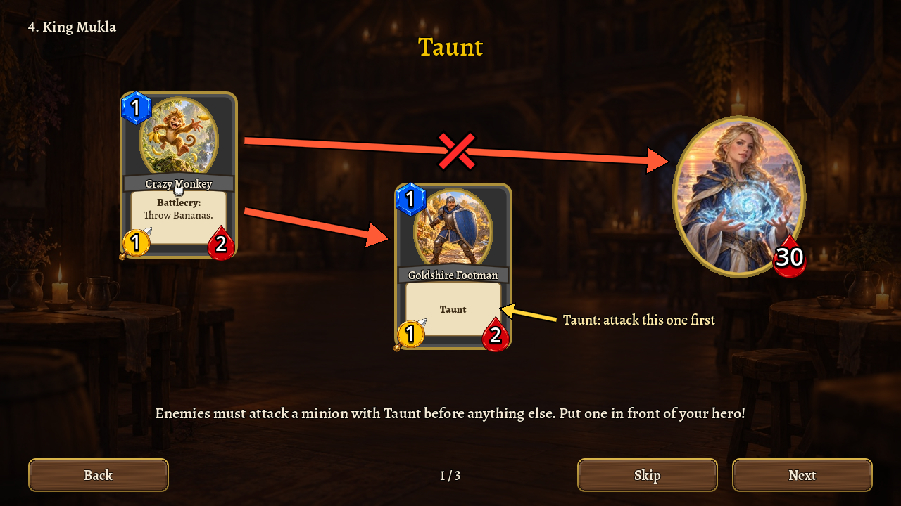 | 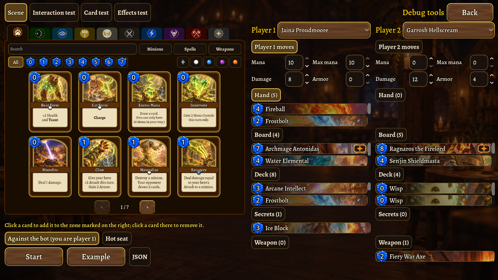 |

## Downloads

Every version tag `vX.Y.Z` builds a [GitHub release](https://github.com/pycz2/classichs/releases/latest) with:
Windows (`.exe`), Linux (`.AppImage`), macOS (`.zip` with the app, not notarized: right-click → Open the first time),
Android (`.apk`) and the web build (`.zip`). The workflow is `.github/workflows/release.yml`; it runs the tests and
calls `tools/export_all.sh`, which also works locally (`tools/export_all.sh web windows macos linux`).
For a stable Android signature add the secrets `ANDROID_KEYSTORE_BASE64`, `ANDROID_KEYSTORE_USER`,
`ANDROID_KEYSTORE_PASSWORD`; without them each build is signed with a new throwaway key.

## Build and run

You need [Godot 4.7.2](https://godotengine.org/) (standard build, no C#) and its export templates for the web build.

```sh
godot --path .                 # run the game
./run_tests.sh                 # run all tests (headless)
./run_tests.sh -- deck_code    # only tests whose "file:method" contains the text
tools/build_site.sh            # web build + landing page into build/site
tools/build_site.sh --publish  # ... and publish to the gh-pages branch
```

Other tools: `tools/extract_cards.py` rebuilds `data/cards.json` from HearthstoneJSON; `tools/gen_audio.py` synthesizes `audio/*.wav`.

## Music sets

Settings → Music set chooses the music; the sounds are always the generated ones:

- **Generated** — `audio/*.wav`, synthesized by `tools/gen_audio.py`.
- **Open (CC0)** — `audio/open/*.ogg`, tracks by RandomMind from OpenGameArt, public domain (CC0): menu — [Minstrel Dance](https://opengameart.org/content/medieval-minstrel-dance); battle — [The Old Tower Inn](https://opengameart.org/content/medieval-the-old-tower-inn), [King's Feast](https://opengameart.org/content/medieval-kings-feast), [The Bard's Tale](https://opengameart.org/content/medieval-the-bards-tale). `tools/fetch_open_music.py` downloads and encodes them.

## Card art sets

Every folder in `art/` is a picture set, selectable in Settings → Card art:

- `art/cards/` — illustrations generated with the local Codex CLI (`tools/gen_card_art.py`).
- `art/original/` — the original art from [HearthstoneJSON](https://hearthstonejson.com/docs/images.html) (`tools/fetch_original_art.py`). It belongs to Blizzard, so it stays out of git and out of the published web build: local play only.
- Your own set: create `art/<any name>/` and put pictures named by card id (`CS2_029.jpg`, `VAN_EX1_298.png`, `HERO_08.webp`…). The next build picks the folder up and the set appears in the settings. Cards without a picture in the set use the drawn art.

## How it is built

| Folder | What is there |
|---|---|
| `engine/` | Deterministic game engine: entities with tags and enchantments, event queue, death phase, auras, legal actions, state hash. No floats, one seeded RNG. |
| `cards/` | One hook dictionary per card (battlecry, deathrattle, triggers, auras, cost changes…), by class. |
| `game/` | Match controller, bot, decks and deck codes, tutorial missions, settings, locale, sound, deck tracker. |
| `net/` | Transport (WebRTC data channel), signalling codes, session protocol (hello, start, actions with state hashes, emotes). |
| `ui/` | All screens, built in code; procedural art. |
| `tests/` | Over 640 tests: every card, engine rules, deck codes, network protocol, UI flows, random full-game simulations. |
| `site/` | The GitHub Pages landing page. |
| `docs/superpowers/` | Design specs and implementation plans with the decisions taken. |

## На русском

Фанатский ремейк Hearthstone Classic (июнь 2014): все 382 карты, девять классов, обучение как в оригинале, тренировка с ботом и игра с другом по сети прямо в браузере без игрового сервера — обычная или Арена (драфт как в 2014 году, до трёх побед) — коды подключения передаются через любой мессенджер. Коллекция, колоды и коды колод, дектрекер, история ходов, инструменты отладки, 8 языков, музыка, звуки и эмоции. Играть: **https://pycz2.github.io/classichs/**

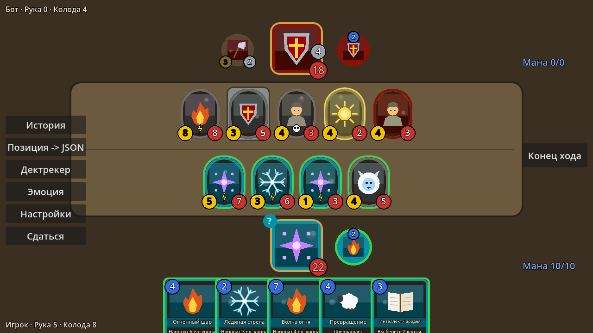

## Legal

Classic HS is a non-commercial fan project and is not affiliated with or endorsed by Blizzard Entertainment. Hearthstone and the card names and texts are trademarks and property of Blizzard Entertainment, Inc. Card data comes from [HearthstoneJSON](https://hearthstonejson.com/). The original card art belongs to Blizzard Entertainment. The code is under the [MIT License](LICENSE).
